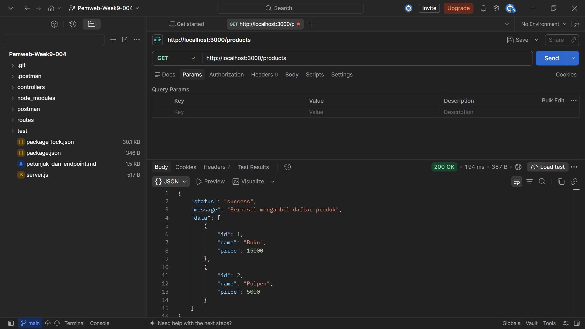
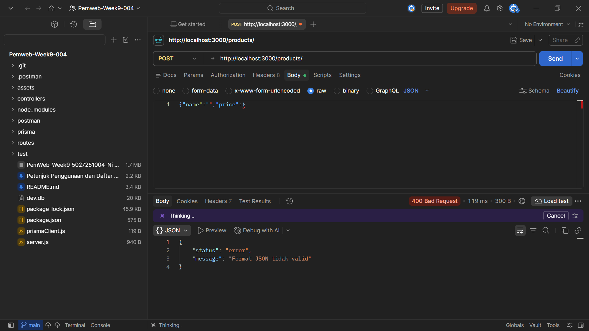
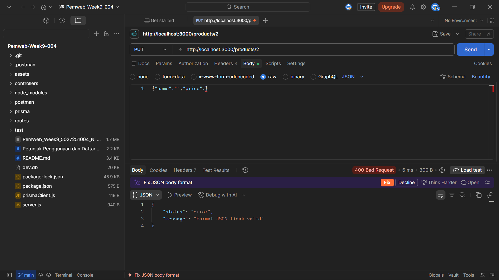
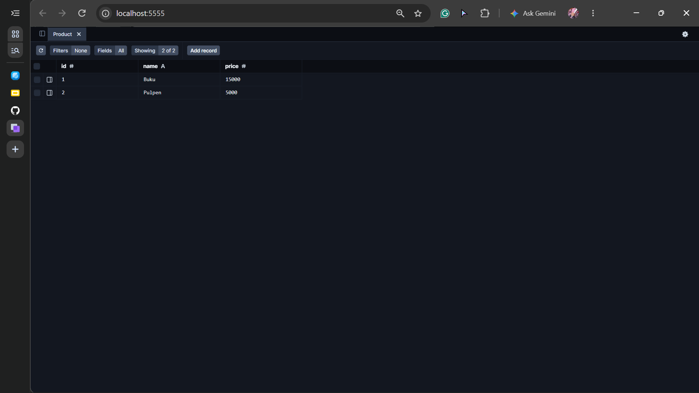
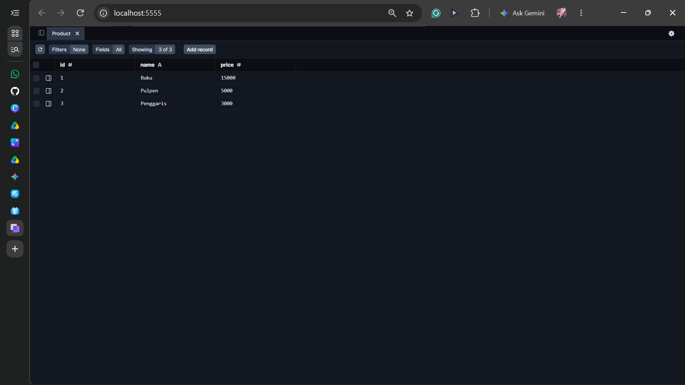

# REST API Produk

Proyek ini adalah REST API sederhana untuk mengelola data produk menggunakan
Express.js, Prisma ORM, dan SQLite. Pengujian endpoint dapat dilakukan dengan
Postman, Bruno, Hoppscotch, atau `npm test`.

## Teknologi

- Node.js dan Express.js
- Prisma ORM
- SQLite (`dev.db`)

## Persiapan dan menjalankan aplikasi

Pastikan Node.js dan npm sudah terpasang. Dari folder proyek, jalankan:

```bash
npm install
npm run db:migrate
npm run db:seed
npm run dev
```

Server berjalan di `http://localhost:3000`. Data awal:

| ID | Nama | Harga |
|---:|---|---:|
| 1 | Buku | 15000 |
| 2 | Pulpen | 5000 |

## Menjalankan antarmuka React

Jalankan API dengan `npm run dev`, lalu buka terminal lain dan jalankan:

```bash
npm run dev:client
```

Buka `http://localhost:5173`. Vite meneruskan permintaan `/products` ke API
Express di `http://localhost:3000`. Untuk memeriksa hasil build frontend:

```bash
npm run build:client
```

## Endpoint API

Semua endpoint menggunakan base URL `http://localhost:3000`.

| Method | Endpoint | Keterangan | Hasil utama |
|---|---|---|---|
| `GET` | `/products` | Mengambil semua produk | `200 OK` |
| `GET` | `/products/:id` | Mengambil produk berdasarkan ID | `200 OK`, atau `404 Not Found` |
| `POST` | `/products` | Menambahkan produk | `201 Created`, atau `400 Bad Request` |
| `PUT` | `/products/:id` | Memperbarui nama dan harga produk | `200 OK`, `400 Bad Request`, atau `404 Not Found` |
| `DELETE` | `/products/:id` | Menghapus produk | `200 OK`, atau `404 Not Found` |

Body untuk `POST` dan `PUT` harus berupa JSON, dengan nama tidak kosong dan
harga berupa angka lebih dari 0:

```json
{
  "name": "Penggaris",
  "price": 3000
}
```

## Menjalankan pengujian otomatis

```bash
npm test
```

Perintah ini menerapkan migrasi, mengisi data awal, lalu menjalankan pengujian
endpoint menggunakan Node.js test runner.

## Laporan bukti pengujian

Screenshot berikut diambil menggunakan Postman. Simpan bukti tambahan di folder
`assets/` dan cantumkan di bagian ini jika skenario pengujian baru sudah
dijalankan.

### Skenario berhasil

**GET `/products` — berhasil mengambil seluruh produk (200 OK).**



**GET `/products/1` — berhasil mengambil produk Buku (200 OK).**


**POST `/products` — berhasil menambahkan Penggaris dengan ID 3 (201 Created).**


### Skenario kesalahan

**GET `/products/999` — ID tidak ditemukan (404 Not Found).**


**POST `/products` — format JSON tidak valid (400 Bad Request).**



**PUT `/products/2` — format JSON tidak valid (400 Bad Request).**



### Perubahan data database

Data sebelum POST berisi dua produk (ID 1 dan 2):



Data setelah POST berisi tiga produk, termasuk Penggaris (ID 3):



Hasil `GET /products` setelah penambahan juga menunjukkan ketiga produk:


## Link Repository GitHub
https://github.com/queenta-wijaya/Pemweb-Week-9-10-004